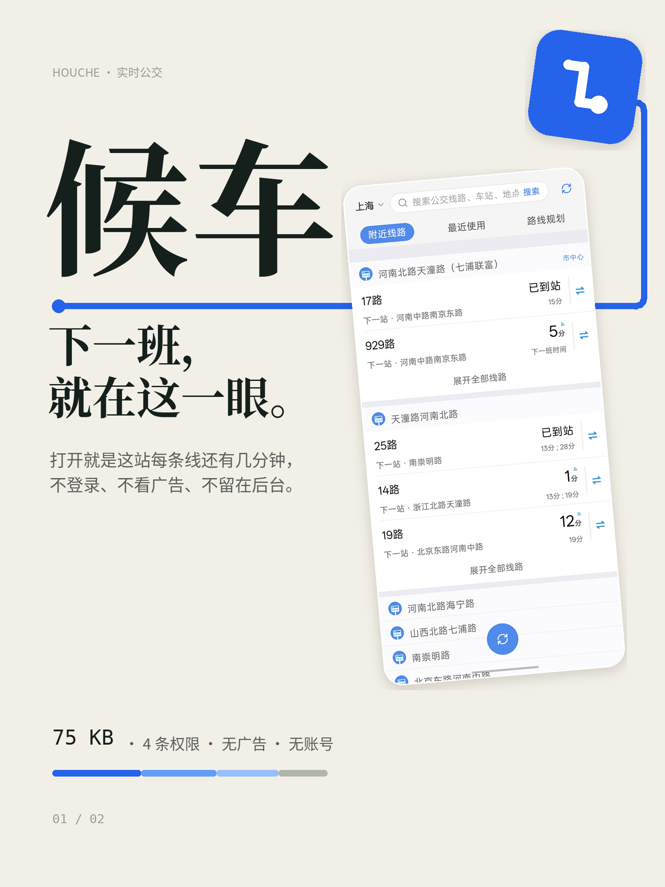
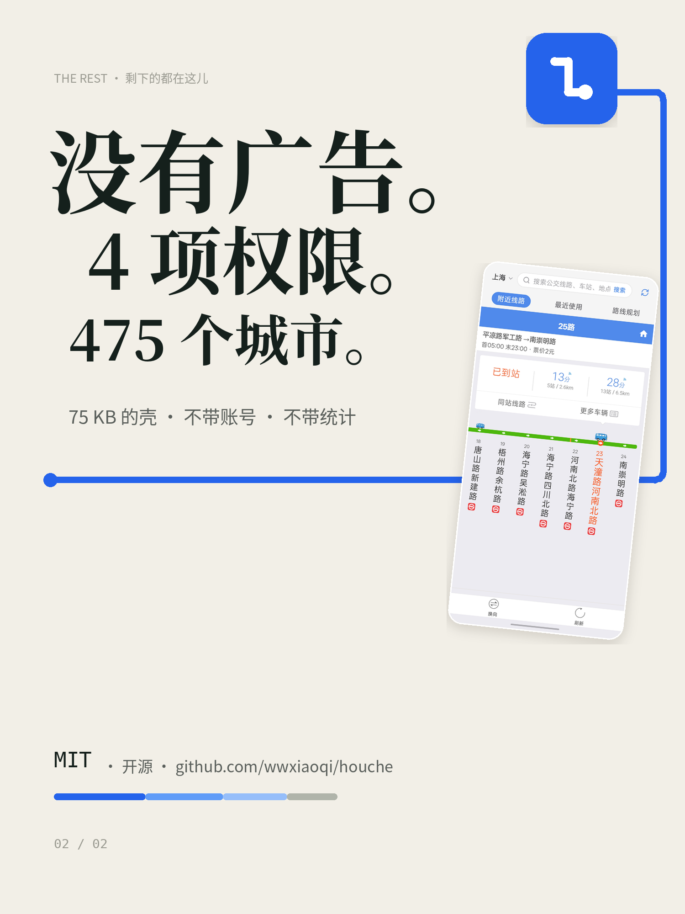

<h1>候车 · Houche</h1>

<b>下一班还有几分钟，应该在打开的那一眼里。</b>

A thin native shell around a live bus web app — 75 KB, 4 permissions, no ads, no analytics of its own.

  
  
  
  
  
  

  
  

75 KB · 没有广告 · 4 条权限 · 475 个城市

---

## 这是什么

打开它，第一眼是这一站所有线路还有几分钟。

**候车**是一个 **75 KB 的外壳**：里面跑的是实时公交的网页，外面这一层是我自己写的 —— 顶栏（城市 / 搜索 / 刷新）、三格 tab、沉浸式边到边。它只申请 **4 条权限**：联网、网络状态、粗定位、精定位。没有广告，没有统计 SDK，没有账号，没有后台常驻。

它不假装自己是原生 App。数据来自网页，界面也来自网页；这一层外壳只做三件事：**把网页自己的顶栏和 tab 收掉、把配色接过来、把系统栏和手势条处理好**。

## 能做什么

- **附近线路** —— 按当前位置列出最近的站点，每站每线的下一班到站时间与「下一站·某某」都在。
- **最近使用** —— 查过的线路留在这里，长按不需要，点叉即可删；空态可以一键清空。
- **路线规划** —— 起点默认「我的位置」，点终点进位置搜索，出公交换乘方案。
- **切城市** —— 覆盖 475 个城市；点顶栏城市名进网页城市页，选完回来自动刷新。
- **搜索** —— 顶栏输入框就地输入，回车即搜；线路、车站、地点一个框都认。
- **左右滑动切 tab** —— 在 tab 栏上横划就能换页，不用伸手去点。
- **任意页面可用的刷新** —— 列表页右下角一颗圆钮（矢量图标，永远清晰）；详情页用网页自己的「换向 / 刷新」栏。

## 权限

| 权限 | 为什么需要 |
|---|---|
| `INTERNET` | 加载网页 |
| `ACCESS_NETWORK_STATE` | 没网时直接给原生离线页，不把白屏的 WebView 亮出来 |
| `ACCESS_COARSE_LOCATION` | 网页的「附近线路」要靠定位 |
| `ACCESS_FINE_LOCATION` | 同上，精确到哪一侧站台 |

相机、麦克风、存储、通知、振动、常亮**一个都没要**。代价：网页里的「拍照上传」不可用（相册选图不受影响）。

## 反馈

界面哪里别扭、注入没生效、某个城市列表不对，欢迎开 [Issue](https://github.com/wwxiaoqi/houche/issues)。这个项目没有服务器也没有账号，改一个选择器、换一个图标、调一个间距，都可以单独成一次提交。

## 商标与数据

- 网页内容、线路数据与「车来了」相关标识归**深圳车来了科技有限公司**所有。本项目**与其没有任何关联**，也不是官方客户端；它只是一个把自己的浏览器壳写干净一点的个人工具。
- 仓库里**不包含**任何接口密钥、签名算法或抓包数据 —— 数据由网页自己取，壳不碰。
- 功能图标来自 [Lucide](https://lucide.dev)（ISC 许可），转为 VectorDrawable 使用；启动图标为自制。

## 许可

[MIT](LICENSE)
